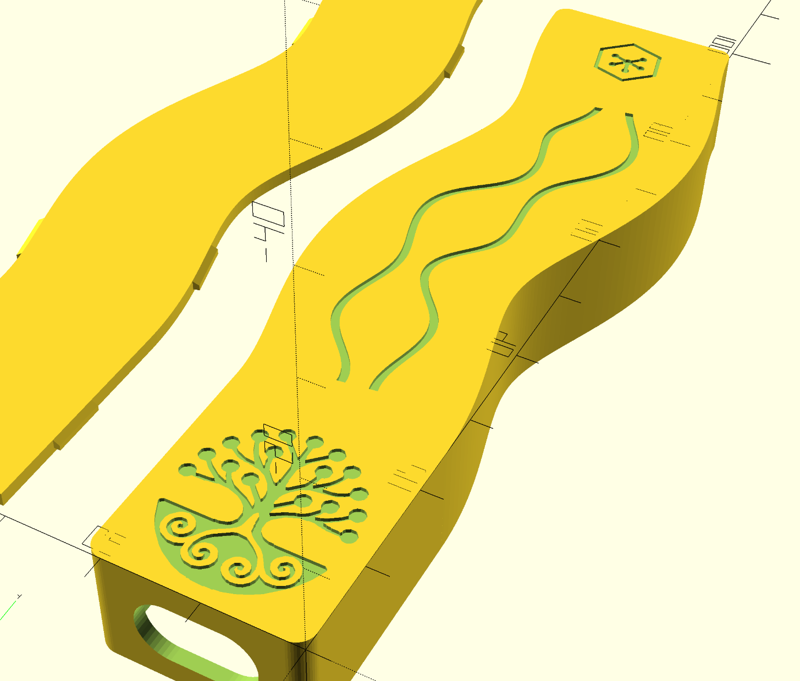

# Mariko Earthgrids & Reality2 Device Cases

Parametric OpenSCAD enclosures for Mariko Earthgrids field devices, branded with the Reality2 network hallmark.



## Overview

This repository contains parametric case designs for various Mariko Earthgrids devices. Each device has its own directory with source files, STL exports, documentation, and verification tools.

## Devices

| Device | Description | Status |
|--------|-------------|--------|
| [Xiao + LoRa](xiao/) | Phone-mount case for Seeed Xiao + LoRa board | ✅ Production |
| [Heltec router](router-heltec/) | Pi 3 + Heltec V4R8, close-fitting screen opening, GPS holder and two rear antenna mounts | Digital prototype; physical fit pending |
| [Home router](router/) | Pi + DFR1195 enclosure with external USB access and removable covers | USB access revision; print fit pending |
| [Compact battery holders](battery-holder/) | Reinforced curved holders; single protected-cell version with 67 mm base and one-ended overhang | Short-cell version user-tested; 69 mm protected-cell STL available for fit checking; raised two-cell layout cannot clear the lid |

## Project Structure

```
mariko-xiao-case/
├── branding/           # Shared branding assets (logos, images)
├── xiao/              # Xiao + LoRa device case
├── router/            # Pi + DFR1195 home router enclosure
├── router-heltec/     # Pi 3 + Heltec V4R8 + GPS variant
├── CLAUDE.md          # Project context and invariants
└── README.md          # This file
```

## Shared Assets

The `branding/` directory contains shared branding assets used across devices:

- `branding/logos/` - Logo source files (SCAD traces, SVGs)
- `branding/images/` - Reference images and comparisons

### Branding Elements

All Mariko Earthgrids devices carry the Reality2 hallmark and may include:

- **Mariko tree mark** - Auto-traced from the official logo, mirrored to read correctly after installation flip
- **Reality2 hexagon** - Pointy-top ring with hub-and-five-spokes node network (top vertex direction empty)
- **Braided river waves** - Decorative element flowing along device features

Branding is debossed ~0.4mm into visible faces (prints as crisp first-layer engraving). Feature sizes are kept above ~0.45mm for 0.4mm nozzle compatibility.

## Building

All devices use OpenSCAD for parametric design. See individual device directories for:

- Source files (`src/`)
- STL exports (`stl/`)
- Test and preview scenes (`test/`)
- Verification tools (`scripts/`)

## Contributing

When adding a new device:

1. Create a new directory following the structure of existing devices
2. Include source, STL exports, documentation, and verification tools
3. Update this README with the new device entry
4. Document any device-specific invariants in CLAUDE.md

## License

Device-specific licensing is at the discretion of Mariko Earthgrids.

## AI-assisted work

Run `./start-ai.sh` from this repository to select Codex or Claude Code, or
use `./start-ai.sh codex --new`. The launcher starts in this repository and keeps
its local session state separate from the PCB and core projects. It requires Bash,
tmux, Python 3, a systemd user manager and the selected agent CLI. It uses the
existing workspace convention of automatic tool permissions. Read the project
instructions before changing designs; geometry validation requirements still apply.
Use `./start-ai.sh --help` for recovery and session options.
