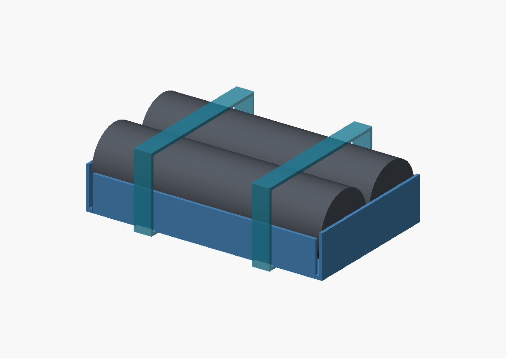
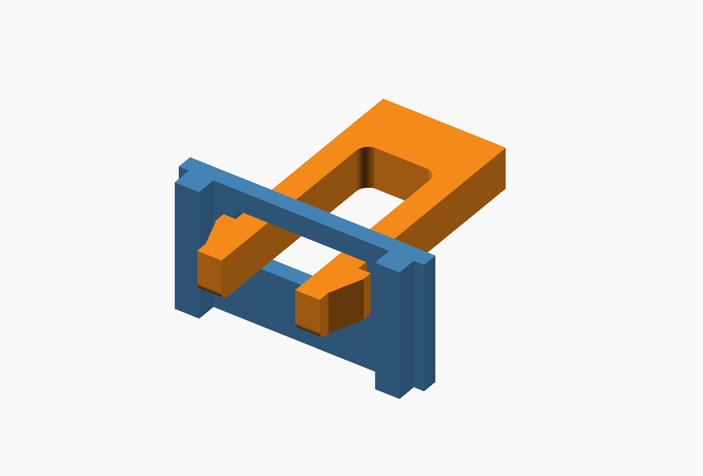
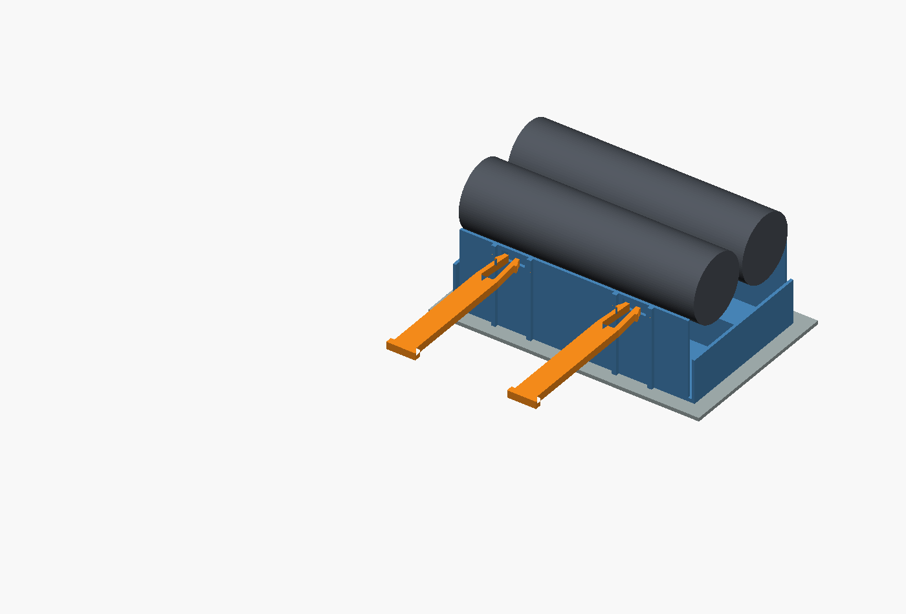

# Compact Radar Sensor Box battery holders

## Longer protected cells — revision pending

The user has confirmed that **only one or two cells fit the Radar Sensor Box;
three do not fit**. The new protected cells are reported to be just under 5 mm
longer than the previous cells, including the raised cap. Exact length and
diameter are still needed before generating replacement print files.

The latest retention proposal is **curved press-in lips on the holder itself**,
replacing the separate bars. Two 24 mm-long curved retaining sections per cell allow
the upper lips to flex for insertion/removal while the base stays fixed. Continuous
end walls provide backing for copper tape, with 1.2 mm relief gaps between the
curved sections and the ends. Keep
adjacent cells' flexing sections independent and round the entry/contact edges.
The diameter, opening, wall thickness and print material determine the grip;
use a small PETG fit trial after measuring the new cells.


The [retention study](concepts/snap-cradle.scad) uses the old 18 mm diameter as a
placeholder and retains the previous 66.8 mm length for illustration. The end
walls and copper bands are now included, but the study does not yet define the
protected-cell length, raised-cap contact fit, lift or thermistor-plug clearance.
The longer curved sections need a physical grip/removal trial.
No replacement print files have been issued from this study.

Keep the mounting base at the previous 66.8 mm length. The proposed longer upper
cradle can overhang the component end of the battery area. The thermistor plug
is a clearance concern **only for the two-cell holder**; do not impose that
connector-driven lift on the single-cell design unnecessarily. Set the two-cell
lift from the fitted plug/wire height plus clearance, and check the closed lid.
The user's suggested couple of millimetres is not yet a verified lift dimension.

The user also proposes **diagonal placement for the single-cell version**.
Evaluate that alongside the raised/overhanging layout. Check the full cell,
contact walls, curved lips and insertion/removal access, not just the cell's length
against the area's diagonal. A rectangular screening check against the recorded
66 × 54 mm reservation finds that even a bare 68 × 18 mm rectangle fits only near
35.1°, while a 69 × 18 mm rectangle does not fit at any angle. The existing
66.8 × 21.9 mm tray envelope also does not fit diagonally within that strict
rectangle. These are envelope checks, not measurements of the new cell or proof
that all space beyond the reservation is obstructed. A diagonal design needs
the actual usable outline and new cell dimensions; do not assume it avoids a lift.

**The files and dimensions below are the previous short-cell design.** They
have not been revised for the new protected cells. The three-cell files are
retained as historical designs, not an option for this box.

## Previous short-cell design

One-, two- and three-cell holders with **rigid slide-through bars and far-end snap
catches**. The base stays fixed to the board while the bars slide out and the
cells lift out. The bars sit directly on the nominal battery tops.




## Print files

Print **one tray and two matching bars**. This design replaces both the early
slide-on rings and the intermediate U clips; reprint the tray and retainers.

| Cells | Tray | Bar (print two) | Assembled size, L × W × H |
|---|---|---|---|
| One | [battery-1-tray.stl](stl/battery-1-tray.stl) | [battery-1-bar.stl](stl/battery-1-bar.stl) | **66.8 × 24.9 × 22.2 mm** |
| Two | [battery-2-tray.stl](stl/battery-2-tray.stl) | [battery-2-bar.stl](stl/battery-2-bar.stl) | **66.8 × 44 × 22.2 mm** |
| Three — does not fit this box | [battery-3-tray.stl](stl/battery-3-tray.stl) | [battery-3-bar.stl](stl/battery-3-bar.stl) | **66.8 × 63.1 × 22.2 mm** |

Widths include the pull head and the protruding catch. The tray alone, including
outside strengthening ribs, is 21.9 / 41 / 60.1 mm wide. Mounting adhesive,
wiring and finger/tool access are additional. The three-cell version exceeds the
radar PCB's recorded 54 mm battery reservation and the user confirms it does
not fit this box. Protected-cell lift and closed-lid clearance remain unmeasured.

The [contact-fit piece](stl/battery-contact-fit.stl) matches the single-cell tray,
66.8 × 21.9 × 22.2 mm. It can be used with the single-cell bars. Its narrower
contact wall does not reproduce the stiffness of the larger holders.

## Insertion, locking and replacement

Place the cells in the holder, then push each orange bar sideways through the
aligned slots. The rounded leading underside helps avoid a sharp edge at the
wrapper. The two short prongs at the far end squeeze together as their ramps
pass through the wall, then snap outward. Their rear shoulders catch behind the
far wall and prevent the bar withdrawing. The pull head stops over-insertion.

To remove a bar, squeeze its **two far-end prongs together**, then pull the head
back through the slots. Approximately 0.9 mm movement per prong at the tip is
modeled. Only these short prongs flex; the main bar stays rigid. Remove both
bars before lifting the batteries out. Ease the copper contact walls if needed
rather than scraping a wrapper.



Allow side withdrawal travel of approximately **23.4 / 42.5 / 61.6 mm** for the
one-, two- and three-cell versions, plus space to grip the head and pinch the
far-end catch. Open the enclosure lid for lifting the cells. Verify both side
access and overhead access before permanently fixing the base down.

The floor and eight rib feet form a flat mounting surface. Nothing passes under
the tray. Use the chosen insulating adhesive/mounting pad; its thickness adds to
the installed height. No PCB-specific screw holes have been added. Keep adhesive
off the moving contact walls and bar paths.

## Height and stiffness

The floor is 1 mm thick, so an 18 mm-diameter cell reaches **19 mm** above the
mounting surface. Each bar's flat underside is also at **19 mm**: there is no
intentional gap above the battery and no designed compression of its wrapper.
The bar is 2 mm thick, making its top 21 mm high. The 22.2 mm-tall walls include
the slot clearance and roof. Real printer/cell variation still needs a fit check.

The bar is 6 mm wide. It passes through the outer walls and, on multi-cell trays,
through supports between cells. This limits each unsupported span to one cell.
The inside faces remain straight for vertical cell removal. External ribs stiffen
the outer walls without narrowing the battery lifting path. Rounded fork roots
reduce sharp stress concentrations; the catch has not been fatigue tested.

## Cell length and copper tape

The user reported cells **64 mm long × 18 mm diameter**, including their wrappers.
The first 65.8 mm-long print was about 1 mm tight and splayed at the ends. The
user then approved a **67 mm maximum outside length**. The current length is
66.8 mm, adding exactly 1 mm of internal spacing with a 0.2 mm nominal print margin.

The source keeps the original 64 mm report separate from a 1 mm empirical fit
allowance. The preview and clearance envelope are therefore 65 mm long; this is
not a new battery measurement. The relaxed plastic contact spacing is 64.8 mm,
or 64.6 mm after the assumed 0.1 mm copper-plus-adhesive at each end. A perfectly
64 mm cell in a dimensionally perfect print would have clearance; the actual
next print must establish contact pressure rather than assuming the proxy does.

Both end walls remain continuous, 0.8 mm thick, with 0.2 mm modeled movement
around the fit envelope. Stick one copper strip across the inside of each end
wall. Insulate it except at the intended terminal patches, especially near the
positive terminal's surrounding can. The illustrated 4 × 3 mm exposed patches
must suit the actual terminal geometry. Do not wrap tape around outside ends
or bond the end-wall relief gaps; both would defeat the length/flex allowance.
Route leads clear of the bar paths and make joints before installing cells.

Tape thickness, chemistry and terminal details remain unconfirmed. The user
originally described Ni-Cd cells. These are mechanical parts; they do not establish
charger compatibility, contact resistance or electrical pack qualification.

## Printing and physical checks

- Start with PETG, a 0.4 mm nozzle and 0.2 mm layers. Print at 100% scale.
  Use 0.4 mm line width for the 0.8 mm contact walls and 1.2 mm latch prongs.
- Print the tray floor down and bars flat as exported. The forks flex in the
  layer plane. The slot roofs have 6.4 mm bridges; inspect their underside and
  clear stray strands before insertion. No support material should occupy slots
  or the fork gap.
- Check bar motion and both catches on each bar before fitting live cells.
  Do not force a binding bar or a latch that fails to spring back.
- Check each actual cell fits, each bar rests lightly on it, and all contacts
  remain stable. Measure the loaded length: it must not exceed 67 mm.
- Dry-fit in the real box and replace the cells with the base held flat before
  bonding it down. Latch force, repeated release, warm-box creep, wrapper wear,
  electrical contact and mounting strength remain physical checks.

## Source and verification

The shared source is [src/battery_holder.scad](src/battery_holder.scad).
Set `cells=1`, `2` or `3`; parts include `tray`, `bar`, `contact-fit`,
`assembly`, `service`, `tape-preview` and `latch-detail`.

After geometry changes:

```sh
python3 battery-holder/scripts/build.py
```

Set `OPENSCAD=/path/to/openscad` if needed. The build uses OpenSCAD and Python's
standard library. [test/verification.json](test/verification.json) records:

- Connected, watertight printable meshes, envelope dimensions and flat mounting area.
- Contact spacing measured from the exported tray, continuous tape backing and clear end-wall relief.
- Clear seated cells/bars, individual far-end hook engagement and the head stop.
- Bar underside at 19 mm and each cell's contact within a 0.05 mm lift.
- Cell retention allowing the bar its full 0.2 mm upward slot clearance, plus slot-roof retention.
- Conservative swept clearance for the squeezed bars withdrawing sideways and cells lifting out above a fixed board.

The squeezed-fork and seated-contact-wall shapes are geometric proxies, not
force/strain simulations. A digital pass does not establish latch strength or
electrical contact. Tiny common-coordinate quantization below 0.000008 mm avoids
OpenSCAD 2021 CGAL seams; it does not change practical fit dimensions.

Refresh previews through the user's existing XRDP session:

```sh
DISPLAY=:10 python3 battery-holder/scripts/render.py
```

The earlier plain-bar illustration remains in `concepts/` as a historical
concept. Use the current source and STLs above for the locking-bar revision.
