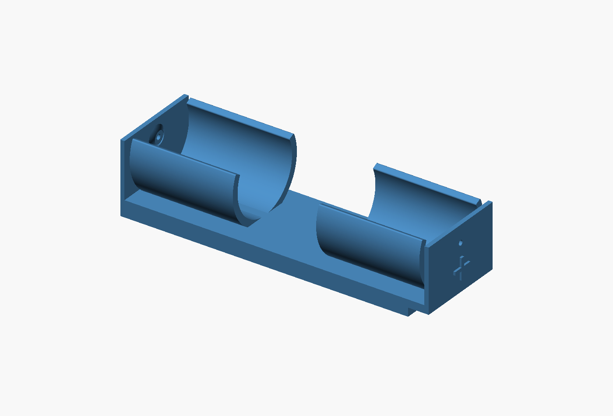
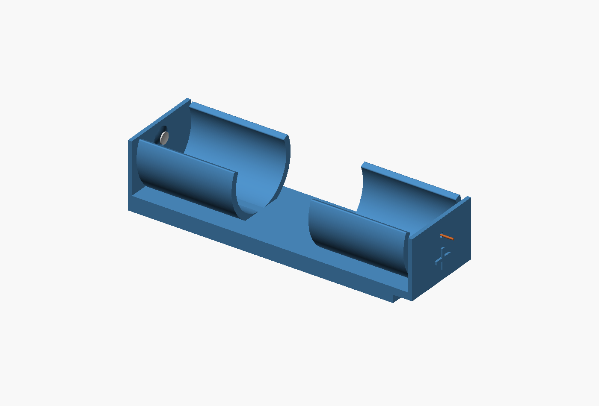
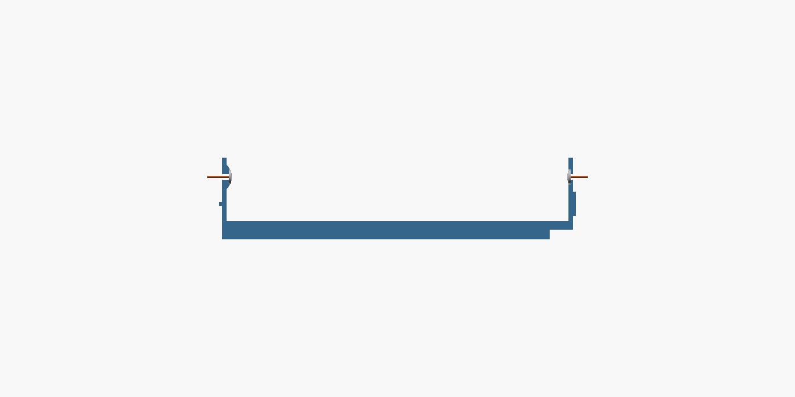
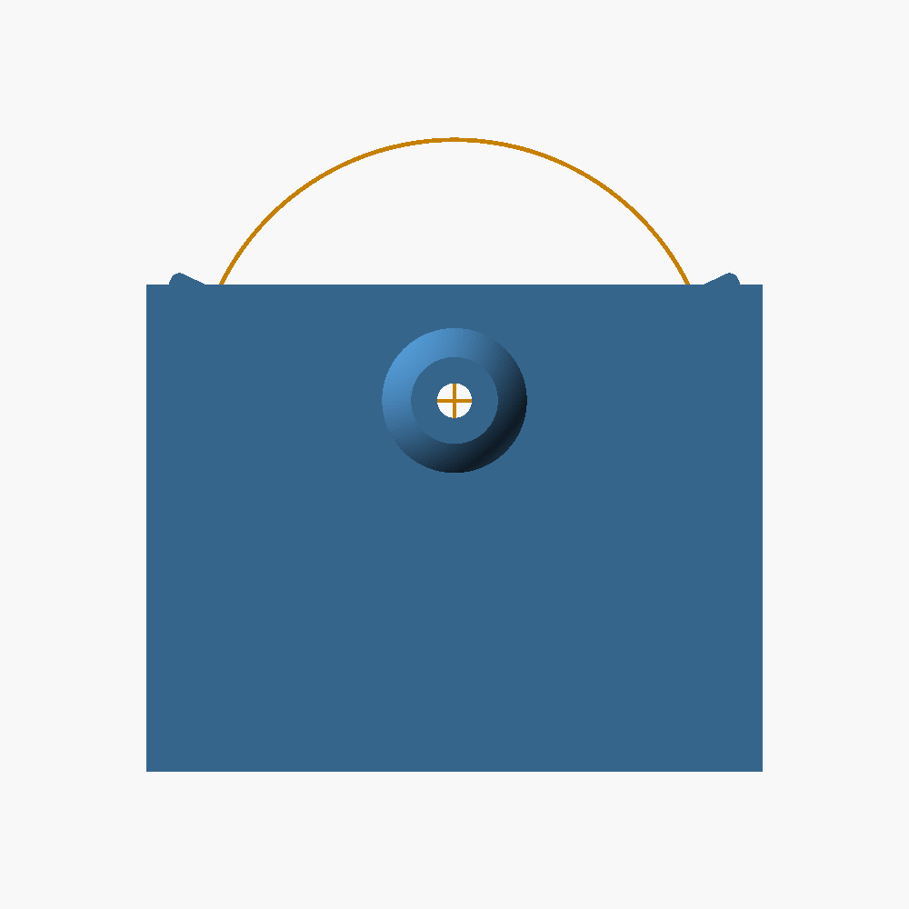
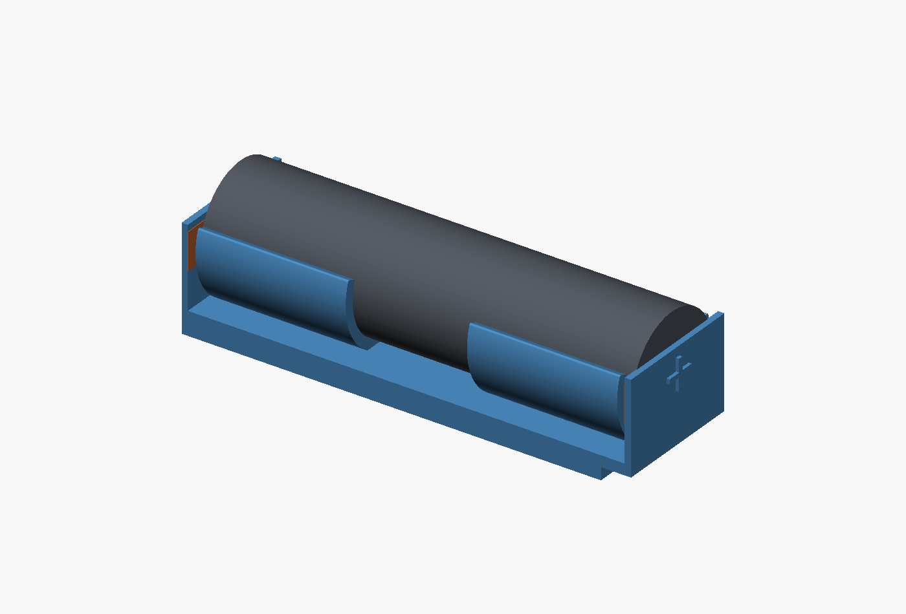
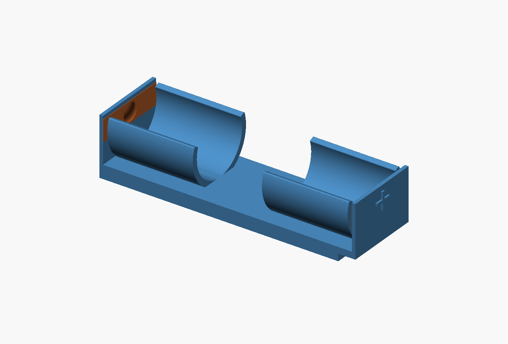
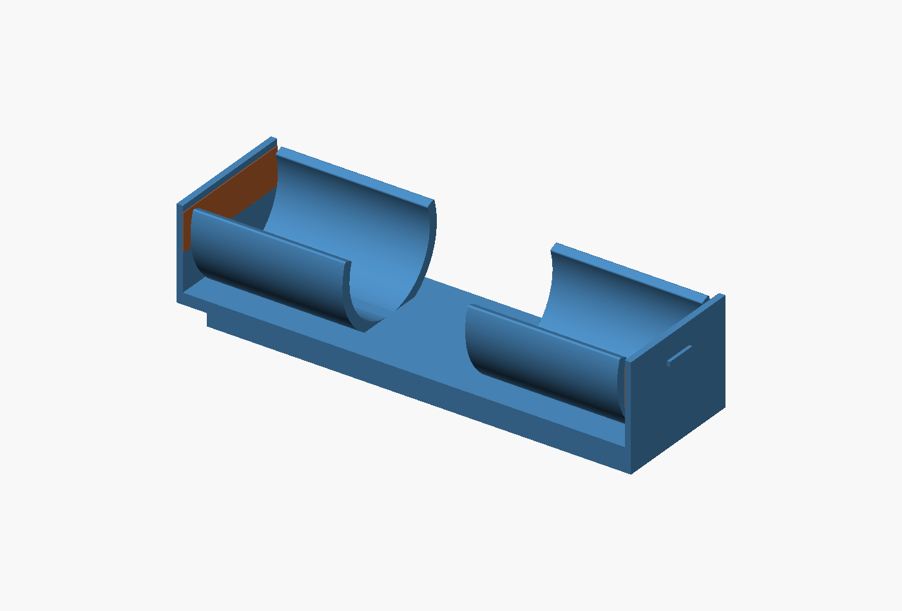

# Compact Radar Sensor Box battery holders

## Wired-contact alternative — experimental

The copper tape was too fragile in the user's trial. This separate variant
replaces it with bare-wire feed-throughs and small solder-head pockets. The
[original copper-tape version](stl/battery-1-protected-snap-tray.stl) remains available.

- [Printable wired-contact tray](stl/battery-1-protected-wired-tray.stl)
- [Parametric source](src/wired_snap_cradle.scad)
- Each end has a **1.2 mm through-hole** and an inward-facing **3 mm-diameter
  solder pocket**. At the **negative end**, the pocket is recessed 0.5 mm into
  the nominal top of the retained **5 mm-wide, 1 mm-high bump**. Its floor has
  1.5 mm of backing around the wire hole. At the **positive end**, the pocket
  is 0.5 mm deep in the flat 1 mm wall, leaving 0.5 mm backing.
- The user's insulated wire is about **1 mm** across; only the stripped
  conductor sits in the hole when assembled. Its bare diameter remains unmeasured.
  The 1.2 mm bore lets the insulated body pass through while threading the wire
  from the inside, after forming the solder head away from the plastic. Check
  the actual printed clearance before assembling.
- Both holes and solder pockets lie on the **battery centreline**: 10.65 mm
  from either side and **12.8 mm above the mounting surface**. This is above
  the flap's midpoint because the battery extends above the flap.
- Polarity marks remain raised 0.5 mm and now sit **5.5 mm below the holes**:
  minus at the flush end, plus at the overhanging end. The wire goes through
  the central hole, not through either symbol.

The 67 mm mounting base, 71.8 mm body, 2 mm step, 25° curved lips and 1.6 mm
shells are preserved. The plastic envelope including marks is
**72.8 × 21.3 × 17.2 mm**. External wire routing needs additional space.
Only the plastic tray is included in the STL; the preview's silver contacts
and copper-coloured wires are illustrations, not printed parts.

The illustrated solder heads are **2.8 mm wide** to fit the 3 mm pockets.
At the negative end, aim for a solder peak **1.0 mm above the flat inner wall**,
level with the bump's original, unrecessed apex. This is 0.5 mm above the pocket
floor; the remaining curved rim around the recess is lower than that peak.
At the positive end, aim for **0.2 mm above the flat inner wall**, or 0.7 mm
above its pocket floor. These asymmetric targets preserve the **68.6 mm
contact-to-contact gap** and approximately **0.4 mm total end-wall spread**
with a 69 mm cell. Do not add the earlier 0.6 mm protrusion on top of the bump.
Actual solder shapes vary; measure the peaks and check the physical fit.

Form the soldered ends on the wires away from the printed holder, with the
battery removed. Feed the free wire ends from the pocket side out through the
holes and seat the cooled heads in the pockets. Secure the insulated wire
outside the flaps so a pull does not load the small contact seats. Do not solder
to the battery itself; see [Panasonic's battery safety guidance](https://www.panasonic.com/global/energy/study/academy/safety.html).
The printed pockets locate the contacts; contact resistance, current capacity,
wear, solder shape and end-wall durability have not been validated.

Print base down, cavity up, supporting the 4.8 mm overhang. Check and clear the
small horizontal holes after printing. Rebuild with
`python3 battery-holder/scripts/build_wired_cradle.py` from the repository root;
set `OPENSCAD` for the executable or `--wire-hole` to tune the hole diameter.
The build checks watertightness, footprint, lip opening, both bore diameters,
pocket diameters/depths, the retained negative bump, horizontal and vertical alignment with the battery
axis, wall backing and polarity marks below the holes. It checks the
illustrative heads for pocket clearance and target preload, and requires cell
clearance when each contact end is translated outward by 0.2 mm. This is a
geometry proxy, not a spring or electrical-performance test.






The orange alignment guides are preview overlays only; they are not printed.

## Protected cells — 69 mm version

The user has confirmed **69 mm total battery length including the cap**. The
new [protected-cell source](src/protected_snap_cradle.scad) retains the working
curved grip, 1.6 mm shells, 1.8 mm cradle floor and continuous copper-tape ends.
The protected-cell revision is now **single-cell only**. The user reports that
raising two batteries above the thermistor would prevent the lid from closing.

The retaining curves now extend **25° above the battery equator**, up from 20°,
adding about 0.8 mm of inner arc at each lip. They retain the 1.6 mm wall
thickness and rounded tips. The measured mesh opening is **16.59 mm**, and the
printed height is **17.2 mm**. The narrower opening increases geometric capture;
actual insertion/removal force and resistance to shaking still need a print
trial. The taller lips remain below the top of the installed cell.

The upper tray body is **71.8 mm long**, with **69.8 mm between the flat end
walls**. A **5 mm-wide, 1 mm-high rounded bump** inside the flush end backs the
negative copper contact. The end wall stays continuous behind it. Press the
tape smoothly over the bump when applying it.

The bump leaves a **68.8 mm plastic gap**, or **68.6 mm** with the illustrative
0.1 mm tape at each end. For the user's 69 mm battery, this deliberately asks
the ends to spread **0.4 mm in total** (about 0.2 mm per end if shared equally).
The user explicitly requested this outward flex to improve tape contact.
This replaces the previous 0.5 mm bump and its loose-fit allowance. Actual
contact pressure, insertion force and long-term wall flex need a physical trial.
The preview cell is centred in the preloaded position; relaxed assembly views
therefore show intentional overlap at the end contacts.

Raised **− and + marks** sit on the outside end flaps, **0.5 mm proud**, using
5 mm-wide symbols with 0.8 mm strokes. The **−** is at the bumped, flush end;
the **+** is at the opposite end. These marks add 0.5 mm beyond each end of the
body, making the relaxed maximum length **72.8 mm including the marks**.
Leave the outside marks visible when routing the copper tape. End-wall movement
under preload adds to the installed length; the lid/box fit needs a physical check.

The mounting plinth remains **67 mm long**, flush with the body at X=0. The
upper body overhangs **4.8 mm at the opposite end** (+X), in addition to the
raised mark there. Aim this extension towards the available space. The mounting
base was shortened from 68 to 67 mm after the user found it tight between the
components; neither the bump nor the marks change that mounting footprint.

- [Single-cell protected tray STL](stl/battery-1-protected-snap-tray.stl):
  **72.8 × 21.3 × 17.2 mm** relaxed printed envelope including polarity marks,
  with a **67 × 21.3 mm** mounting face. Body length is 71.8 mm.
  The shallow step is **2 mm**; installed cell top is 21.8 mm above the mounting
  surface. The step is not intended to lift the battery above the thermistor.

**Diameter is still assumed to be 18 mm**, carried over from the working short
cells. The raised cap's detailed shape and electrical contact pressure are not
modeled. The 69 mm length is confirmed; diameter, closed-lid space and physical
fit still need checking. The single-cell layout does not overlap the thermistor
plug; its lift preserves the short mounting footprint under the longer tray.

Print base down with the cavity upwards. Provide slicer support under the
4.8 mm cantilever and keep it clear of the flexing lips and relief gaps. Remove
support before mounting. No separate retaining bars are required.

Rebuild with `python3 battery-holder/scripts/build_protected_cradle.py --cells 1`
from the repository root (`OPENSCAD` selects the executable). Override
`--diameter` when measured; `--lift` adjusts the shallow step if a fit trial
requires it. The source and exporter accept only one protected cell. The build checks connected,
watertight meshes, dimensions, the mounting footprint and raised mark shapes.
Relaxed-cell interference must be confined to narrow contact masks at the two
terminal faces. A geometric proxy moves each end outward 0.2 mm and checks cell
clearance; this is not a simulation of bending. Retention at 0.8 mm lift excludes
end-contact pressure, so the curved lips must provide the capture. Checks also
cover empty space under the overhang, exported end-wall/bump positions and the
actual lip opening and height in the mesh.
These checks do not measure spring force, tape performance or print quality.






## Working short-cell curved holder

The latest retention proposal is **curved press-in lips on the holder itself**,
replacing the separate bars. Two 24 mm-long curved retaining sections per cell allow
the upper lips to flex for insertion/removal while the base stays fixed. Continuous
end walls provide backing for copper tape, with 1.2 mm relief gaps between the
curved sections and the ends. Keep
adjacent cells' flexing sections independent and round the entry/contact edges.
The diameter, opening, wall thickness and print material determine the grip;
use a small PETG fit trial after measuring the new cells.


The [retention study](concepts/snap-cradle.scad) uses the old 18 mm diameter as a
placeholder and retains the previous 66.8 mm length for illustration. The end
walls and copper bands are now included, but the study does not yet define the
protected-cell length, raised-cap contact fit, lift or thermistor-plug clearance.
The longer curved sections need a physical grip/removal trial.
Printable fit-test files for this geometry are linked below. They are not sized
for the new, longer protected cells.

### Curved-holder fit-test STLs

The user has confirmed that the reinforced curved holder works with the shorter
unprotected batteries. Keep this working version while developing the longer-cell
variant separately. This confirmation does not establish fit for protected cells.

After feedback that the earlier holders were flimsy, the curved walls are now
**1.6 mm thick** (was 1.2 mm) and the base **1.8 mm thick** (was 1.2 mm).
The inner curves remain concentric with the cells with 0.05 mm radial clearance;
extra shell thickness grows outward. The end walls remain 1 mm, preserving the
length and contact gap. The thicker sides will resist opening more; physical
grip, release force and durability still need a printed trial.

| Variant | Printable tray | Outside size, L × W × H |
|---|---|---|
| Single cell | [battery-1-snap-fit-test.stl](stl/battery-1-snap-fit-test.stl) | 66.8 × 21.3 × 14.8 mm |
| Two cells | [battery-2-snap-fit-test.stl](stl/battery-2-snap-fit-test.stl) | 66.8 × 43.4 × 14.8 mm |

Print one tray, flat base down and opening upwards. These include the curved
sides and both continuous end walls; the preview batteries and copper tape are
excluded. No separate bars are needed. Use the single-cell tray for an initial
PETG grip/removal trial before printing the double.

The plastic end-wall gap is **64.8 mm**, or **64.6 mm** with the illustrative
0.1 mm tape at each end. The cell diameter placeholder is **18 mm**. These are
short-cell fit tests, not final protected-cell holders; they do not include the
proposed raised base/overhang. The assembled cell reaches 19.8 mm above the base,
above the printed tray's 14.8 mm end walls. Physical grip, contact pressure and
print quality remain unverified.

Rebuild with `python3 battery-holder/scripts/build_snap_cradle.py` from the
repository root (`OPENSCAD` can specify the executable). The exporter checks
both files for a single connected, watertight solid, consistent winding and
the dimensions above before publishing them. It also checks seated-cell
clearance and geometric capture with the cells lifted 0.8 mm; this does not
simulate flexing or measure holding force.

The protected-cell version above uses a separate 67 mm base with a one-ended
overhang. The earlier two-cell raised layout was rejected because the required
height over the thermistor would prevent lid closure.

The user also proposes **diagonal placement for the single-cell version**.
Evaluate that alongside the raised/overhanging layout. Check the full cell,
contact walls, curved lips and insertion/removal access, not just the cell's length
against the area's diagonal. A rectangular screening check against the recorded
66 × 54 mm reservation finds that even a bare 68 × 18 mm rectangle fits only near
35.1°, while a 69 × 18 mm rectangle does not fit at any angle. The existing
66.8 × 21.9 mm tray envelope also does not fit diagonally within that strict
rectangle. These are envelope checks, not measurements of the new cell or proof
that all space beyond the reservation is obstructed. A diagonal design needs
the actual usable outline and new cell dimensions; do not assume it avoids a lift.

**The files and dimensions below are the previous short-cell design.** They
have not been revised for the new protected cells. The three-cell files are
retained as historical designs, not an option for this box.

## Previous short-cell design

One-, two- and three-cell holders with **rigid slide-through bars and far-end snap
catches**. The base stays fixed to the board while the bars slide out and the
cells lift out. The bars sit directly on the nominal battery tops.


## Print files

Print **one tray and two matching bars**. This design replaces both the early
slide-on rings and the intermediate U clips; reprint the tray and retainers.

| Cells | Tray | Bar (print two) | Assembled size, L × W × H |
|---|---|---|---|
| One | [battery-1-tray.stl](stl/battery-1-tray.stl) | [battery-1-bar.stl](stl/battery-1-bar.stl) | **66.8 × 24.9 × 22.2 mm** |
| Two | [battery-2-tray.stl](stl/battery-2-tray.stl) | [battery-2-bar.stl](stl/battery-2-bar.stl) | **66.8 × 44 × 22.2 mm** |
| Three — does not fit this box | [battery-3-tray.stl](stl/battery-3-tray.stl) | [battery-3-bar.stl](stl/battery-3-bar.stl) | **66.8 × 63.1 × 22.2 mm** |

Widths include the pull head and the protruding catch. The tray alone, including
outside strengthening ribs, is 21.9 / 41 / 60.1 mm wide. Mounting adhesive,
wiring and finger/tool access are additional. The three-cell version exceeds the
radar PCB's recorded 54 mm battery reservation and the user confirms it does
not fit this box. Protected-cell lift and closed-lid clearance remain unmeasured.

The [contact-fit piece](stl/battery-contact-fit.stl) matches the single-cell tray,
66.8 × 21.9 × 22.2 mm. It can be used with the single-cell bars. Its narrower
contact wall does not reproduce the stiffness of the larger holders.

## Insertion, locking and replacement

Place the cells in the holder, then push each orange bar sideways through the
aligned slots. The rounded leading underside helps avoid a sharp edge at the
wrapper. The two short prongs at the far end squeeze together as their ramps
pass through the wall, then snap outward. Their rear shoulders catch behind the
far wall and prevent the bar withdrawing. The pull head stops over-insertion.

To remove a bar, squeeze its **two far-end prongs together**, then pull the head
back through the slots. Approximately 0.9 mm movement per prong at the tip is
modeled. Only these short prongs flex; the main bar stays rigid. Remove both
bars before lifting the batteries out. Ease the copper contact walls if needed
rather than scraping a wrapper.


Allow side withdrawal travel of approximately **23.4 / 42.5 / 61.6 mm** for the
one-, two- and three-cell versions, plus space to grip the head and pinch the
far-end catch. Open the enclosure lid for lifting the cells. Verify both side
access and overhead access before permanently fixing the base down.

The floor and eight rib feet form a flat mounting surface. Nothing passes under
the tray. Use the chosen insulating adhesive/mounting pad; its thickness adds to
the installed height. No PCB-specific screw holes have been added. Keep adhesive
off the moving contact walls and bar paths.

## Height and stiffness

The floor is 1 mm thick, so an 18 mm-diameter cell reaches **19 mm** above the
mounting surface. Each bar's flat underside is also at **19 mm**: there is no
intentional gap above the battery and no designed compression of its wrapper.
The bar is 2 mm thick, making its top 21 mm high. The 22.2 mm-tall walls include
the slot clearance and roof. Real printer/cell variation still needs a fit check.

The bar is 6 mm wide. It passes through the outer walls and, on multi-cell trays,
through supports between cells. This limits each unsupported span to one cell.
The inside faces remain straight for vertical cell removal. External ribs stiffen
the outer walls without narrowing the battery lifting path. Rounded fork roots
reduce sharp stress concentrations; the catch has not been fatigue tested.

## Cell length and copper tape

The user reported cells **64 mm long × 18 mm diameter**, including their wrappers.
The first 65.8 mm-long print was about 1 mm tight and splayed at the ends. The
user then approved a **67 mm maximum outside length**. The current length is
66.8 mm, adding exactly 1 mm of internal spacing with a 0.2 mm nominal print margin.

The source keeps the original 64 mm report separate from a 1 mm empirical fit
allowance. The preview and clearance envelope are therefore 65 mm long; this is
not a new battery measurement. The relaxed plastic contact spacing is 64.8 mm,
or 64.6 mm after the assumed 0.1 mm copper-plus-adhesive at each end. A perfectly
64 mm cell in a dimensionally perfect print would have clearance; the actual
next print must establish contact pressure rather than assuming the proxy does.

Both end walls remain continuous, 0.8 mm thick, with 0.2 mm modeled movement
around the fit envelope. Stick one copper strip across the inside of each end
wall. Insulate it except at the intended terminal patches, especially near the
positive terminal's surrounding can. The illustrated 4 × 3 mm exposed patches
must suit the actual terminal geometry. Do not wrap tape around outside ends
or bond the end-wall relief gaps; both would defeat the length/flex allowance.
Route leads clear of the bar paths and make joints before installing cells.

Tape thickness, chemistry and terminal details remain unconfirmed. The user
originally described Ni-Cd cells. These are mechanical parts; they do not establish
charger compatibility, contact resistance or electrical pack qualification.

## Printing and physical checks

- Start with PETG, a 0.4 mm nozzle and 0.2 mm layers. Print at 100% scale.
  Use 0.4 mm line width for the 0.8 mm contact walls and 1.2 mm latch prongs.
- Print the tray floor down and bars flat as exported. The forks flex in the
  layer plane. The slot roofs have 6.4 mm bridges; inspect their underside and
  clear stray strands before insertion. No support material should occupy slots
  or the fork gap.
- Check bar motion and both catches on each bar before fitting live cells.
  Do not force a binding bar or a latch that fails to spring back.
- Check each actual cell fits, each bar rests lightly on it, and all contacts
  remain stable. Measure the loaded length: it must not exceed 67 mm.
- Dry-fit in the real box and replace the cells with the base held flat before
  bonding it down. Latch force, repeated release, warm-box creep, wrapper wear,
  electrical contact and mounting strength remain physical checks.

## Source and verification

The shared source is [src/battery_holder.scad](src/battery_holder.scad).
Set `cells=1`, `2` or `3`; parts include `tray`, `bar`, `contact-fit`,
`assembly`, `service`, `tape-preview` and `latch-detail`.

After geometry changes:

```sh
python3 battery-holder/scripts/build.py
```

Set `OPENSCAD=/path/to/openscad` if needed. The build uses OpenSCAD and Python's
standard library. [test/verification.json](test/verification.json) records:

- Connected, watertight printable meshes, envelope dimensions and flat mounting area.
- Contact spacing measured from the exported tray, continuous tape backing and clear end-wall relief.
- Clear seated cells/bars, individual far-end hook engagement and the head stop.
- Bar underside at 19 mm and each cell's contact within a 0.05 mm lift.
- Cell retention allowing the bar its full 0.2 mm upward slot clearance, plus slot-roof retention.
- Conservative swept clearance for the squeezed bars withdrawing sideways and cells lifting out above a fixed board.

The squeezed-fork and seated-contact-wall shapes are geometric proxies, not
force/strain simulations. A digital pass does not establish latch strength or
electrical contact. Tiny common-coordinate quantization below 0.000008 mm avoids
OpenSCAD 2021 CGAL seams; it does not change practical fit dimensions.

Refresh previews through the user's existing XRDP session:

```sh
DISPLAY=:10 python3 battery-holder/scripts/render.py
```

The earlier plain-bar illustration remains in `concepts/` as a historical
concept. Use the current source and STLs above for the locking-bar revision.
