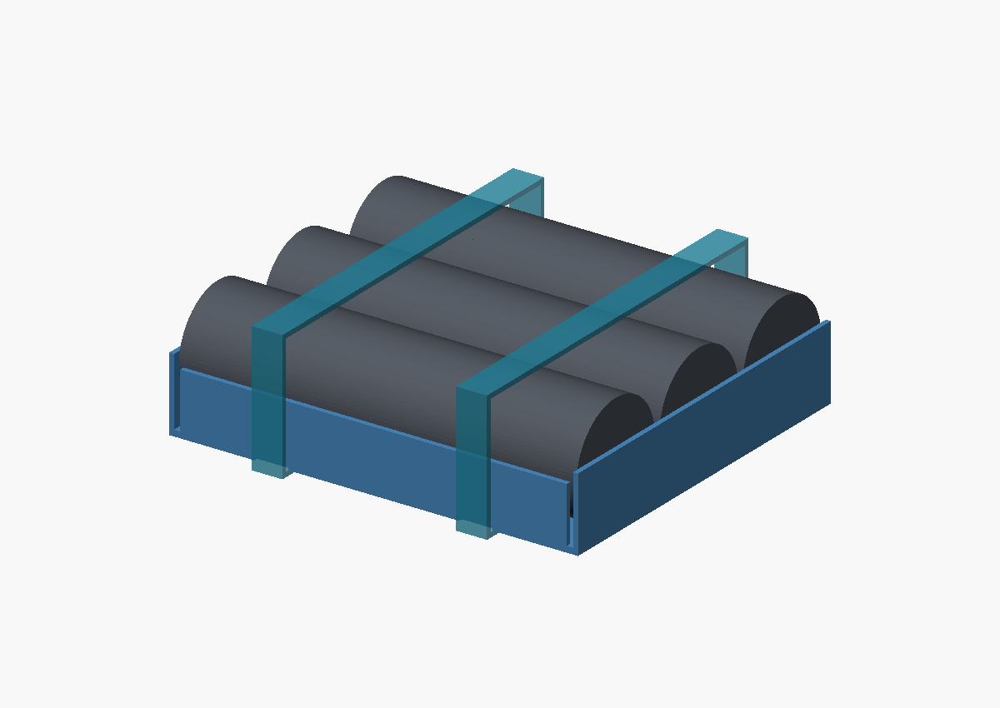
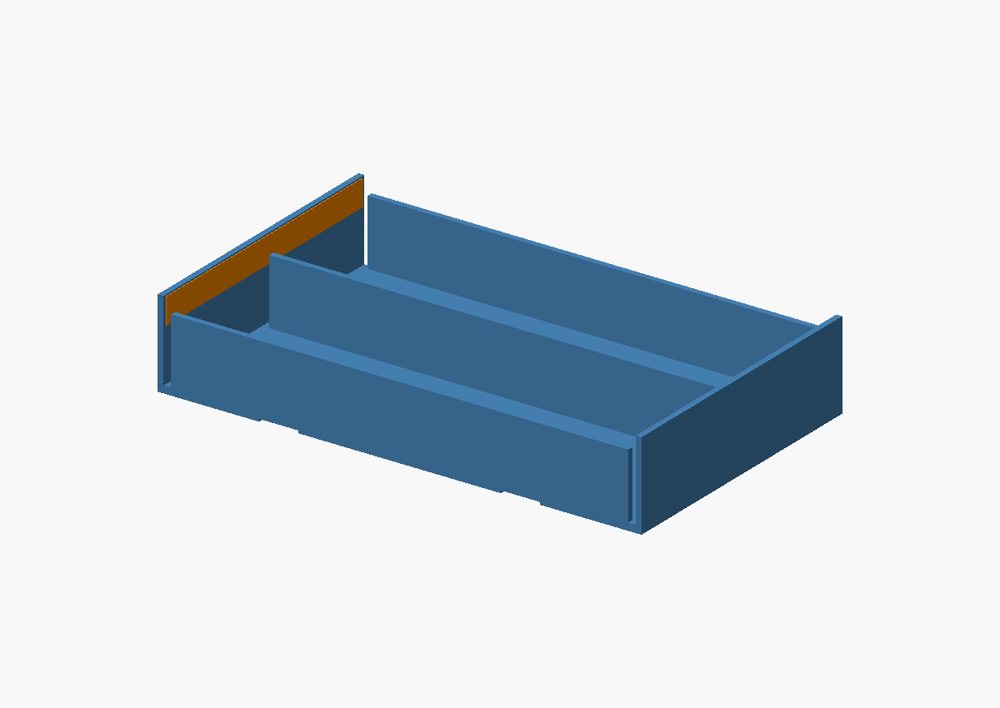

# Compact Radar Sensor Box battery holders

Printable prototypes for **two or three user-measured 64 mm-long, 18 mm-diameter
cells**, side by side with the same polarity orientation for parallel connection.
The user's **66 mm maximum length** is a hard design constraint. Nominal length
is **65.8 mm**, leaving 0.2 mm total for manufacturing variation. Measure the
finished, loaded holder: CAD dimensions do not guarantee a printer's accuracy.




Both ends now have a **continuous wall across the cells**, giving each copper
strip an uninterrupted backing surface. The longitudinal rails stop 0.8 mm
short of each wall's relaxed contact land so the wall can flex from its base.



## Print files and size

| Version | Tray STL (print one) | Retaining band STL (print two) | Loaded size with bands, L × W × H |
|---|---|---|---|
| Two cells | [battery-2-tray.stl](stl/battery-2-tray.stl) | [battery-2-band.stl](stl/battery-2-band.stl) | **65.8 × 41 × 21 mm** |
| Three cells | [battery-3-tray.stl](stl/battery-3-tray.stl) | [battery-3-band.stl](stl/battery-3-band.stl) | **65.8 × 60.1 × 21 mm** |

Print the [one-cell contact-fit piece](stl/battery-contact-fit.stl) first. It
preserves the full 65.8 mm length and end-wall cross-section, using less plastic
than either complete holder. Its printed size is 65.8 × 19.9 × 12 mm.
Its narrower wall does not reproduce the stiffness of a full-width holder.

The trays alone are 65.8 × 39 × 12 mm and 65.8 × 58.1 × 12 mm. Cells project to
19 mm above the tray bottom. Bands add 1 mm on each side and above/below the
loaded tray. These sizes exclude external wiring, adhesive mounting pads and
insulation beyond the modeled terminal tape. Width and height availability
have **not** been confirmed. In particular, the three-cell version exceeds the
54 mm battery-area width recorded in the adjacent radar PCB project.

## Printing and assembly

- Start with PETG, a 0.4 mm nozzle, 0.4 mm line width and 0.2 mm layers. The
  0.8 mm end walls need two sound extrusion lines. This is a starting
  process choice; flexure strength and long-term contact pressure are untested.
- Print every STL as exported at 100% scale. The tray is floor down. Bands
  already lie on their broad rim, so their large opening needs no bridge.
  The tray's 5.4 mm underside grooves require a short bridge. Inspect these
  and remove any brim/elephant-foot flare that increases the outside length.
- Add the copper contacts before installing cells. Seat cells gently; do not
  force the walls beyond the outside end planes or damage a wrapper.
- Slide two matching bands over the loaded tray. Their inside bottom ribs
  locate in the two underside grooves. Slight flex is needed to cross the
  floor and engage the grooves. Check that the bands stay in place and retain
  every cell. Band holding force is not established by the geometric checks.
- There are no mounting screw holes or adhesive pads in this size budget.
  Any box attachment method needs its own clearance allowance.

## Copper tape and the length budget

The user described tape about as thin as masking tape; its actual total
copper-plus-adhesive thickness is still unmeasured. The default allowance is
**0.10 mm at each terminal**, with 0.8 mm printed material behind each contact:

`64 mm cell + 2 × (0.8 mm plastic + 0.1 mm tape) = 65.8 mm`

Each end has one continuous flexible wall shared by all cells. The relaxed contact lands are
0.2 mm inward from their seated position, providing a provisional 0.2 mm travel
per end with the assumed tape. This is a geometry allowance, not a validated
contact-force specification. Thinner tape reduces preload; thicker tape or
longer cells consume the hard length margin. The CAD rejects parameter changes
that require the walls to move beyond the modeled ends. The common wall couples
the contacts, so it no longer provides independent travel for each cell. Check
contact on every cell in the full holder, especially if their lengths differ.

Keep exposed copper confined to each terminal: the preview shows a **4 × 3 mm
central patch**, whose suitability must be checked against the actual cell
terminal. Insulate tape tails, especially near a positive terminal's surrounding
can. Stick one continuous copper strip across the **inside** of each end wall,
at terminal height, and insulate it except at the intended terminal patches.
The tape preview illustrates the continuous conductor before that insulation;
it is not a diagram of the final exposed copper. Route connections sideways at
the wall ends, clear of the retaining bands. Do not wrap tape around the outside
end faces: that adds unbudgeted length. Keep the relief gaps free of tape and
adhesive so the rails do not restrain the moving walls. Make any lead joints away
from the flexing portions and before fitting cells.
Adhesive overlap alone is not a verified electrical joint.

The print supplies mechanical support only; contacts and interconnections are
user-fitted. The originally stated Ni-Cd chemistry has not been confirmed from
the battery label. No charger compatibility or electrical pack qualification is
implied by these mechanical files. The 64 mm dimension must include terminals.

## First physical check

Use the contact-fit piece with the actual tape and each cell in turn. Confirm
the cell seats without force, tape stays on the intended terminals, and contact
remains stable during gentle movement. Measure the maximum outside length with
the cell installed; it must remain at or below 66 mm. Then dry-fit the full
holder and bands in the box before connecting it to the sensor electronics.
Contact resistance, current capacity, creep in a warm box and retention in
service remain physical checks. Do not scale the whole STL to adjust contact
pressure: change the relevant source parameter and rebuild instead.

## Source and verification

[src/battery_holder.scad](src/battery_holder.scad) is shared by both versions.
Set `cells=2` or `cells=3`; choose `part="tray"`, `"band"`, `"contact-fit"` or
`"assembly"`; `"tape-preview"` shows the uninterrupted copper backing surfaces.
All cell and tape dimensions are parameters. Geometry changes
must preserve the hard 66 mm limit and be followed by:

```sh
python3 battery-holder/scripts/build.py
```

Set `OPENSCAD=/path/to/openscad` if it is not on PATH. The script requires only
Python's standard library and OpenSCAD. [test/verification.json](test/verification.json)
records single connected, watertight meshes, expected dimensions, seated-cell
clearance, interference confined to the intended relaxed end walls, band
clearance and geometric retention. Full-width tape-land continuity and the
end-wall relief gaps are checked too. It also checks rejection of an excessive
cell length, tape thickness or outside length. The seated end walls are a clearance
proxy, not a simulation of bending, print anisotropy or contact pressure.

To refresh the CAD previews using an existing desktop/XRDP display:

```sh
DISPLAY=:10 python3 battery-holder/scripts/render.py
```

Use the actual session's display number and X authority. The renderer does not
start another desktop. Both exports were checked with OpenSCAD 2021.01.
