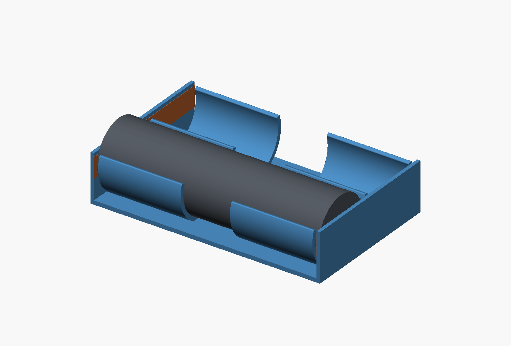
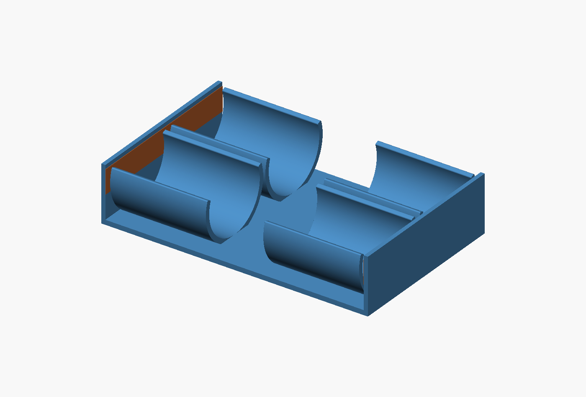

# Retention concepts

## Curved press-in cradle — latest study

`snap-cradle.scad` illustrates two **24 mm-long curved retaining sections per
cell**, extended from the first study's 6 mm sections. A central 14.4 mm gap
leaves access to the cell and separates the flexing sections. The upper lips
turn slightly past the cell's widest point; adjacent lanes have independent
arms and rounded entry edges.

Both ends now have **continuous full-width walls** for copper tape. They are
1 mm thick and 14.2 mm high, reaching 4 mm above the illustrative terminal
centre, with flat tops for wrapping tape over. Copper-coloured bands show the
contact locations. A 1.2 mm gap separates each curved section from the end wall
so the wall does not brace the upper lips. The floor joins everything together.

This is a concept for one or two cells. It retains the previous **66.8 mm length**
and **18 mm placeholder diameter**, with 1.2 mm shell and floor and a 20° wrap
above the equator. The 64.6 mm grey cylinders illustrate the space between the
0.1 mm tape placeholders; they are not measurements of the new cells. Longer
sections will resist opening more than the earlier short sections; grip and
removal force need a physical trial before choosing final thickness/opening.

Views are `part="assembly"`, `"section"` and `"empty"`; set `cells=1` or `2`.
The default shows one occupied lane and one empty lane. `occupied_cells` controls
that illustration; `part="tray"` supplies the bare concept geometry for checks.

The protected-cell length, raised cap/contact geometry, mounting lift and
thermistor clearance remain pending. No replacement print files have been issued.

## Earlier taller-wall, slide-through bar concept

`slide-through.scad` is the historical plain-bar concept requested for review.
It has been superseded by the locking-bar implementation in
`../src/battery_holder.scad`, whose bars rest on the cells and have far-end
squeeze-release catches. Use the current STLs and main README for printing.

Two rigid orange bars pass sideways through slots above the cells. The taller
blue outer walls support them; local towers on the internal dividers support
the two- and three-cell bars between cells. The flat base stays on the board.
Continuous copper-tape contact walls remain at the ends.

The illustrative tray is 66.8 mm long and 22.8 mm high. Its width is 19.9, 39 or
58.1 mm for one, two or three cells. Pull heads add 2 mm on one side and bar tips
0.5 mm on the other. The bars are 6 mm wide and 2 mm thick, with 0.2 mm nominal
clearance on each slot face. Cells are shown using the existing 65 mm fit envelope
(reported 64 mm plus 1 mm empirical allowance), not a new measurement.

`view="assembled"` shows the closed holder. `view="withdrawn"` shows the bars
fully removed sideways and the cells lifted above the walls; the board and base
do not move. `cells=1`, `2` or `3` selects capacity. `view="empty"` exposes the
slots. The withdrawn view illustrates the significant side access needed.

This concept still needs an anti-withdrawal catch or another locking detail,
confirmation of side access and height in the actual box, printability review
and physical strength/fit checks. If side access is insufficient, a short-slide,
then-lift-out mechanism is the alternative under discussion. No new printable
STLs are supplied from this concept.
