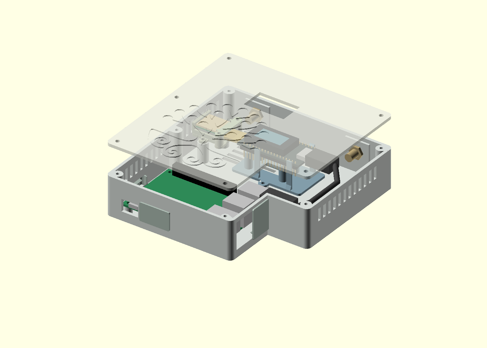
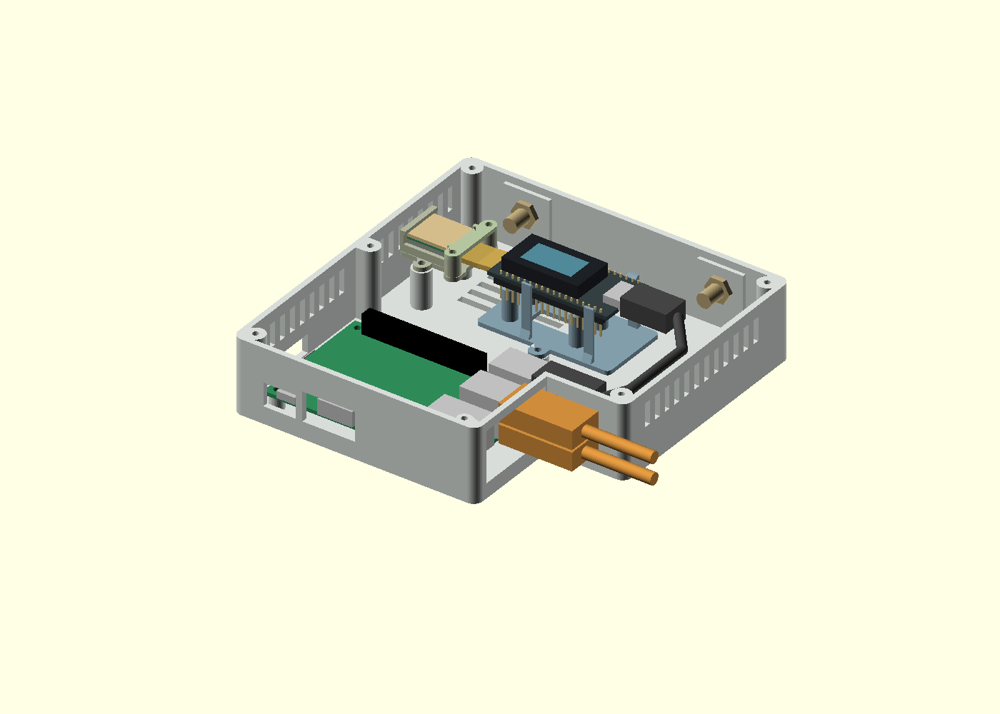
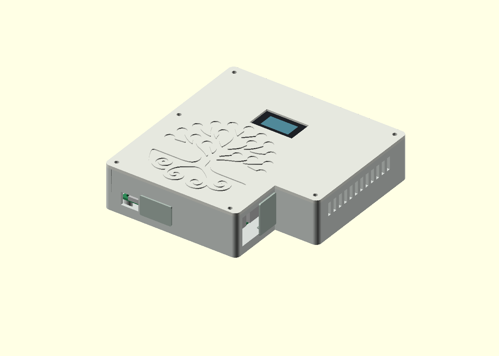
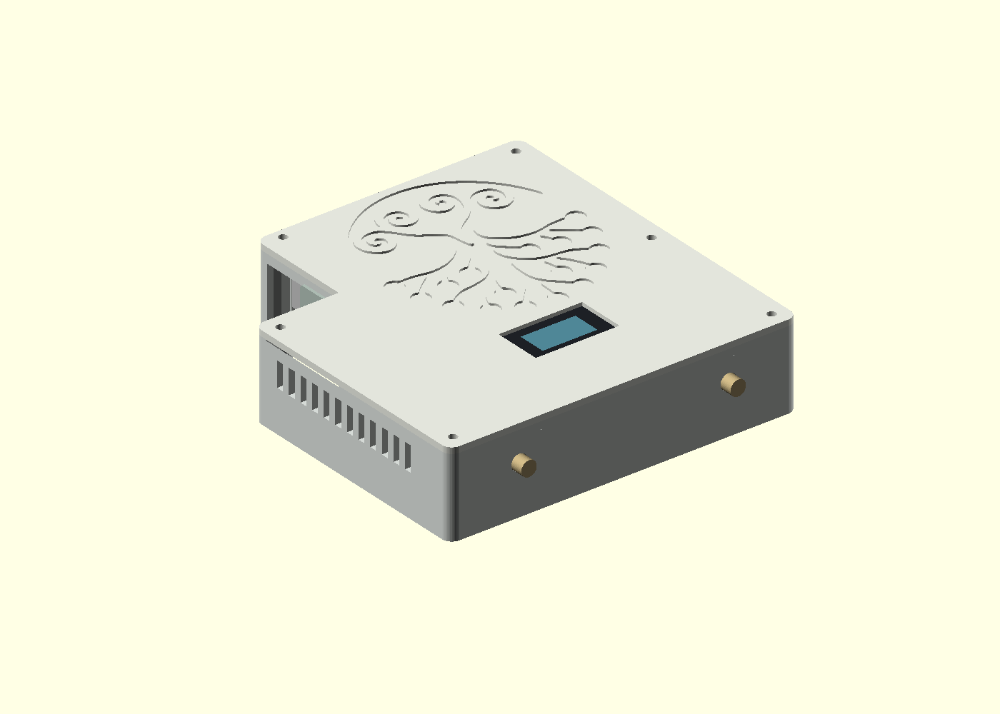
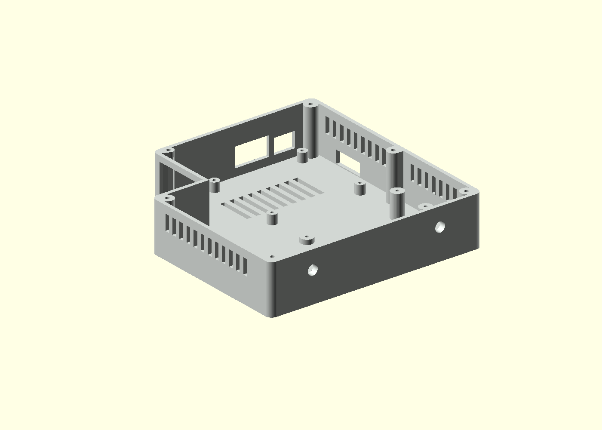
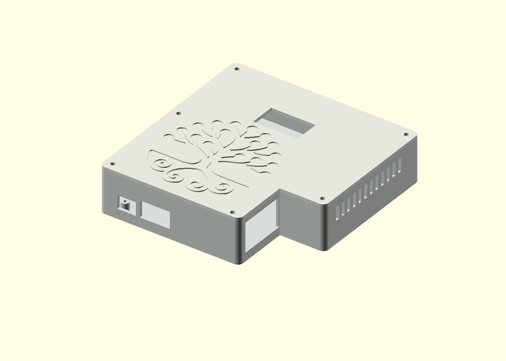
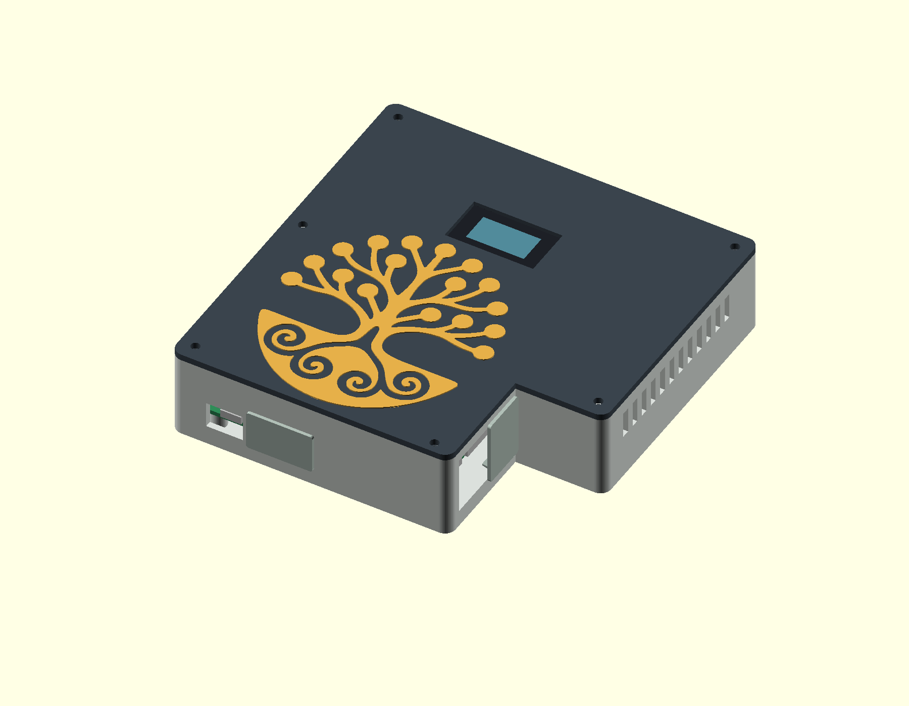
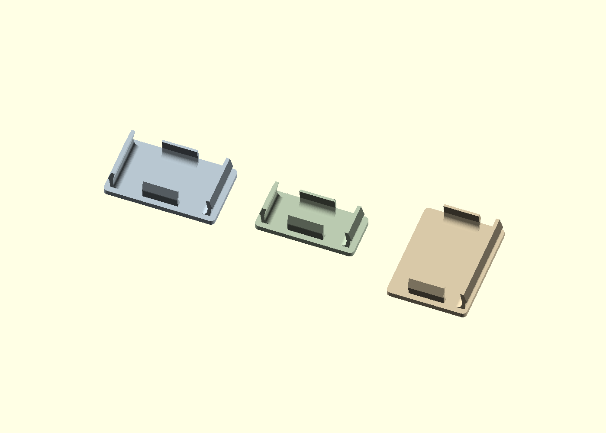
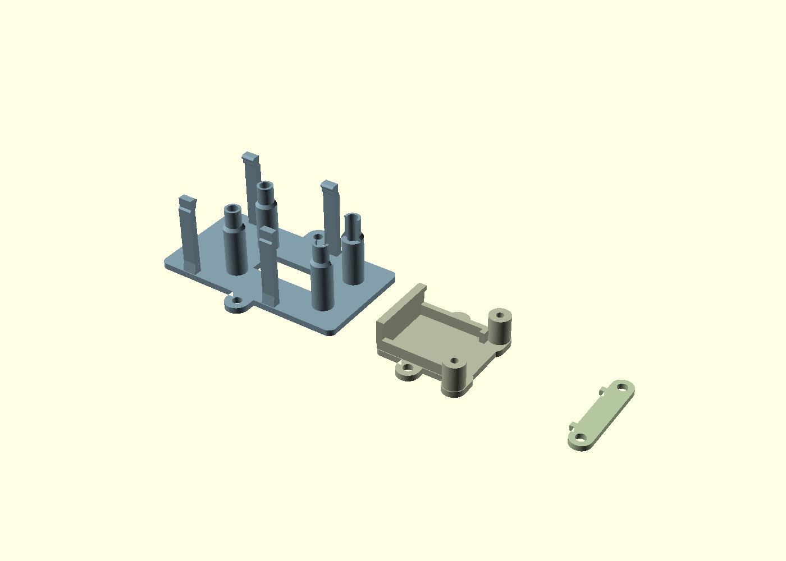
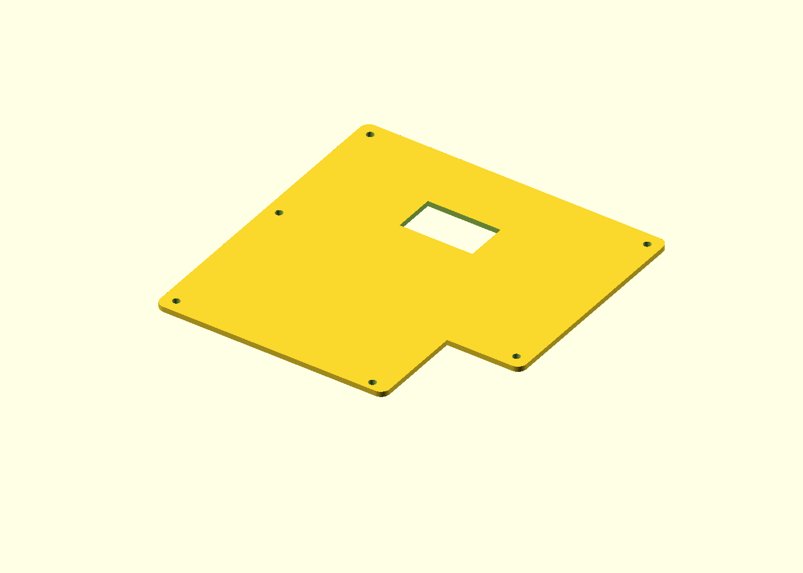

# Pi 3 / Heltec V4R8 router enclosure

A separate variant of the [original router](../router/), using a Raspberry Pi 3,
Heltec WiFi LoRa 32 V4R8 with its factory screen cover, and a GPS accessory.
The case remains **140 × 144 × 34.4 mm**, excluding cover flanges and connectors.
The latest Pi mounting positions, port access, recessed Mariko tree and reinforced
cover clip design are retained. HDMI and USB covers fit the aligned openings
described below.

**Digital prototype: a physical fit and temperature test is still required.**
The original `router/` design is unchanged.







## Design

The Heltec sits on a removable cradle, with its USB-C connector facing the right
cable bay. Four long spring arms retain the PCB edges independently of the lid.
Four hollow support pads clear the factory screen fasteners; reliefs beneath the
GPS-end pads let the connector pass between them. The factory screen cover stays
fitted. The lid surrounds that cover with **0.3 mm clearance per side**; it does
not clamp the display or rely on the glass for retention.

The screen opening is **33.6 × 19.2 mm**. With the provisional 8 mm-thick USB-C plug,
the screen cover top sits **1.2 mm below the lid surface**. A local recess beneath
the lid clears the plug while retaining a **1.2 mm roof**. Changing the plug height
parameter automatically adjusts the cradle height and lid pocket together.
A 6 mm-thick plug allows the display to sit 0.3 mm below the surface.

The GPS holder sits at the Heltec expansion end, allowing the user's measured
**38 mm extension** from the Heltec PCB edge to the far end of the GPS. Its tray
holds an **18 × 16 × 7 mm** module, with the ceramic antenna facing upward.
A rear lip and removable two-screw bridge retain the module with clearance;
the cable leaves through the open end. The antenna's central face is uncovered.
No fragile snap fingers are used on the GPS holder.

Two rear antenna holes are at **X=28 and X=112 mm**, both **Z=20 mm**, so each is
28 mm from its nearest side. Both currently use **6.5 mm clearance holes** and
**4 mm reinforced panels**, with room for an 11 mm nut and 10 mm internal tail.
The bores use 128 segments, independently of the other geometry, keeping the
CAD facet error at about 0.001 mm radially. Printed ovality or a sagging upper edge
is a separate print-process issue; this resolution change addresses CAD facets.
The user reports oval/flattened holes after printing and currently uses a
0.6 mm nozzle. They will try slicer-generated supports on the next print.
Use local support enforcers at the two bores, permitting supports to start on
the model rather than restricting them to the build plate. See
[Prusa's bridging guidance](https://help.prusa3d.com/article/poor-bridging_1802).
Remove those supports before fitting the bulkheads; no sacrificial webs are
built into the STL.
The left position is for Wi-Fi; the right is for LoRa. Each hole diameter can be
adjusted independently to match the actual bulkhead. Confirm connector type and
usable thread length for each pigtail; the printed case has no RF connector threads.

The two USB sockets nearest Ethernet remain accessible with the lid closed.
The user measured a **15 mm-wide USB plug** that would not pass the previous
12.5 mm opening. The base now follows their hand-cut fix: remove the divider
between Ethernet and USB, and extend the USB edge **2 mm towards the corner**.
The joined opening is **36 × 22 mm**, spanning Y=6.25..42.25 and Z=6.4..28.4.
Both USB sockets are checked simultaneously with **16 mm-wide housings**.
The user's 15 mm plug has 0.75 mm nominal clearance on the corner side; the
16 mm test envelope has 0.25 mm. Socket positions have not moved.

The matching USB cover fills the USB area and the former divider gap, leaving
the **18.5 × 22 mm Ethernet opening** accessible with the cover fitted. Its
three hooked fingers grip the top, bottom and corner-side wall; there is no
clip or projecting flange on the Ethernet edge. The corner flange is 0.6 mm
wide to clear the stepped wall. The strengthened clip roots are retained.
The build checks each hook independently, clear space between clip roots,
and Ethernet insertion with the cover installed.

The other USB stack stays internal: upper socket for the Heltec cable, lower
socket free. Pi 3 has onboard Wi-Fi; the inherited nano-dongle envelope is
still checked. HDMI remains 22.8 × 12.6 mm, with its bottom aligned to power
at Z=7.4 mm and the 3 mm divider between them retained. Power and SD access
are unchanged. Reprint the **base and USB cover** for this revision; the HDMI
and SD covers, either lid, logo inlay and internal holders can be reused.
A cover fitted to the hand-trimmed base may need adjustment because its exact
cutback was estimated at 1–2 mm; the exported pair uses 2 mm.



## Optional contrasting logo inlay

The [logo inlay](stl/router-heltec-logo-inlay.stl) is now **80 mm wide**, twice the
width and height of the original tree. The user reported that the 40 mm version
fitted but was fiddly even with fine printing and a fine nozzle. The branches
are now twice as wide, and the inlay is **1.2 mm thick overall**: **0.8 mm seated
inside the lid**, with the face **0.4 mm proud**. This makes a more substantial
piece to handle; the enlarged version still needs a physical print trial.

**Print the matching new lid and inlay together.** The old 40 mm lid recess and
inlay are not compatible with these files. The base, covers and internal holders
are unchanged and can be reused. The new recess leaves **1.6 mm of lid material**
below it. Its centre is at X=53, Y=47.5 mm, with at least **3 mm clearance** to the
lid edge, screen opening and screw holes.



The inlay remains one connected piece. Both it and the matching lid use the
original `tree` path from the supplied [mariko-sticker.svg](../mariko-sticker.svg).
The [tree-only SVG](references/mariko-tree.svg) preserves those cubic curves
verbatim, excluding the sticker lettering, ring and cutline. Its width is 80 mm
and height 88.322 mm. The CAD samples the curves to within 0.005 mm at this size,
without tracing a bitmap or refitting the artwork. Regenerate the shared profile
with `python3 scripts/import_logo.py`, then run the full build. Source provenance
is recorded in [logo-source.json](references/logo-source.json). The supplied
sticker, shared branding assets and other enclosure variants are unchanged.

The preview colours are illustrative; print it in your preferred
contrasting filament. Most edges retain **0.05 mm clearance per side**. Six small
grip spots retain **0.04 mm local interference** for a light press-fit. The first
0.2 mm has clearance to help it enter; the next 0.6 mm provides the grip. The grip
patches end at the lid surface, leaving the raised face smooth. This is a
friction fit with no undercut or snap catch; CAD interference does not guarantee
holding force with a particular printer or material.

Start with the [root fit piece](stl/router-heltec-logo-root-fit.stl), which uses
three of the same grip spots and fits the lower root area of the matching 80 mm
lid recess. It is a cropped part of the logo, with no extra test socket to print.
The full tree has three additional contacts, so check its fit gently too.

Print **0.2 mm layers, including the first layer**: four layers seat inside the
lid and two form the raised face. Keep the flat seating face on the bed, with
no supports. Keep the original orientation; do not mirror it. Release the part
carefully and seat it by pressing the broad root and circular leaf ends rather
than bending the branches.

If the test is too tight, lower `edge_grip` in
[src/logo_inlay.scad](src/logo_inlay.scad); try 0.02 mm or 0 for a glue-in fit.
If it is loose, try 0.06 mm. Regenerate both parts with
`python3 scripts/build_inlay.py` from this directory. A tiny spot of superglue
under a broad area remains an optional fallback; keep the film thin so it does
not prevent full seating. `proud_height` controls how far the face stands above
the lid; recess depth and tree size come from the main enclosure source.

The [inlay validation report](test/inlay-validation.json) checks both meshes,
the seating depth plus raised height, clearance of the main outline, and small
intentional contact at each grip spot. It also checks there is no interference
elsewhere with the actual lid. The main build checks the 3 mm layout margin.

## Files and printing

- [Editable CAD](src/router_heltec_case.scad)
- [Base](stl/router-heltec-base.stl), [logo lid](stl/router-heltec-lid.stl) and [plain lid](stl/router-heltec-lid-plain.stl)
- [Editable plain lid](src/plain_lid.scad): same screen opening, screw holes and underside USB-C relief, with no logo recess
- [Heltec cradle](stl/router-heltec-heltec-cradle.stl)
- [GPS holder](stl/router-heltec-gps-holder.stl) and [retaining bridge](stl/router-heltec-gps-keeper.stl)
- [HDMI](stl/router-heltec-hdmi-cover.stl), [SD](stl/router-heltec-sd-cover.stl) and [USB](stl/router-heltec-usb-cover.stl) covers
- [Screen fit coupon](stl/router-heltec-screen-fit.stl)
- Optional [logo inlay](stl/router-heltec-logo-inlay.stl) and [root fit piece](stl/router-heltec-logo-root-fit.stl)
- [Validation report](test/validation.json) and [dimension provenance](references/dimensions.json)

Print the screen coupon and holders first to check the actual components before
printing the full enclosure. All exported parts sit on Z=0 in their print
orientation. Base cavity, cradle arms, GPS tray and port-cover clips point upward;
the lid prints with its recessed logo upward. The USB relief in the lid requires
a short bridge. Check this bridge and the small ledges over the GPS connector
reliefs in the cradle when slicing.

For this USB-access revision, **reprint the Heltec base and USB cover**.
The HDMI and SD covers, both lids and internal holders can be reused. The USB
cover from the divided opening is incompatible with the new joined opening.
The SD cover remains geometrically identical to the original `router/` cover.
PETG is the intended next trial material for the flexible arms and covers; neither
spring force nor fatigue has been physically verified. Start with the existing
router's 0.2 mm layers, 0.4 mm nozzle and four perimeters, then inspect the slicer
preview around the narrow support rings and spring roots.





## Assembly

1. Install both antenna bulkheads with their supplied nuts and washers. Keep
   pigtails clear of the screen and GPS antenna; verify connector compatibility.
2. Fit the Pi to its four posts using M2.5 × 6 mm screws. Fit the microSD card.
3. Screw the empty Heltec cradle to its two short base bosses using two
   M2.5 × 5 mm screws. The pilot holes are 2.1 mm; check thread fit in spare plastic.
4. Fit the Heltec, display up and USB-C toward the right cable bay. Gently spread
   the long arms and seat the PCB on the support rings. Check that the factory
   screws, underside connectors and headers clear the supports. Release the arms
   to latch over the PCB edges, keeping force off the display.
5. Screw the GPS tray to its two tall base bosses using two M2.5 × 6 mm screws.
   With its antenna upward, tuck the GPS's far edge beneath the rear lip, then
   lower the connector end into the tray. Connect the lead without tension.
   Fit the retaining bridge with two M2.5 × 6 mm screws; it stops against its own
   posts, leaving clearance above the module.
6. Connect the internal USB data cable to the upper internal Pi socket and route
   it through the right bay to the Heltec. Current envelopes allow a 24 × 12 × 9 mm
   USB-A housing and a 20 × 12 × 8 mm USB-C housing. These are provisional cable
   dimensions, not a guarantee for all plugs.
7. Check the screen cover fits the coupon and lid opening freely. Close with six
   M3 × 10 mm screws. Install the port covers as needed. Add feet for floor airflow.

The Heltec is rotated 180 degrees in the case; adjust display orientation in the
application if needed. Thermal performance, GPS reception and Wi-Fi/LoRa antenna
routing require checks with the actual operating hardware.

## Measurements and tuning

The user confirmed the factory screen cover at **33 × 18.6 mm**, and **7.1 mm**
from Heltec PCB underside to the top of the display. They measured the GPS PCB at
**16 × 18 mm**, its complete connector-to-antenna stack at **7 mm**, and the plugged-in
assembly's extension at about **38 mm**. These override the generic GPS accessory
drawing. Other board positions come from the references listed in
[dimensions.json](references/dimensions.json).

The manufacturer's V4 STEP model omits the OLED and its cover, and is not an exact
populated V4R8 model. The drawing and STEP also differ on mounting-hole diameter.
The CAD therefore uses measured/display envelopes and support pads with 3.2 mm
clearance bores, rather than assuming a particular board fastening screw.
Verify screen position along the board and underside support-pad clearance on
the actual unit. No manufacturer CAD or PDF is redistributed here.

Useful top-level parameters: `screen_cover`, `screen_stack`, `screen_local`,
`screen_clearance`, `usb_c_plug_height`, `gps_size`, `gps_extension`,
`antenna_hole` and `wifi_antenna_hole`. Use the Customizer's `part` selector for
assembly, closed case, service access, separate holders or individual printable parts.
Rebuild all exports after changing parameters: the lid and cradle heights are coupled.

## Build and verification

With OpenSCAD available:

```sh
cd router-heltec
python3 scripts/build.py
```

Or from the repository root with the local tooling image:

```sh
docker run --rm --init --user "$(id -u):$(id -g)" \
  --mount type=bind,src="$PWD",dst=/work --workdir /work/router-heltec \
  r2-3dprint-tools:local python3 scripts/build.py
```

The build exports nine enclosure meshes plus the optional plain lid, inlay and root fit piece.
The plain lid uses the shared design's existing `lid_logo=false` switch. It can
also be exported with `python3 scripts/build_plain_lid.py`; its mesh and matching
overall dimensions are recorded in `test/plain-lid-validation.json`.
It checks connected, watertight geometry;
hardware, holders, antenna fittings and cable envelopes; screen clearance;
closed-lid USB insertion; HDMI/SD and Ethernet access; and individual cover
preload/retention. It also checks that the cradle and GPS retainers engage when
their boards are lifted, measures the aligned edges of the actual wall openings,
checks that previous port clearance is preserved, and compares the SD cover, Pi
mounts and unchanged
clip design against `router/`. Geometric retention does not establish
material strength or insertion force. The results apply to the simplified
envelopes and parameters in the source.
