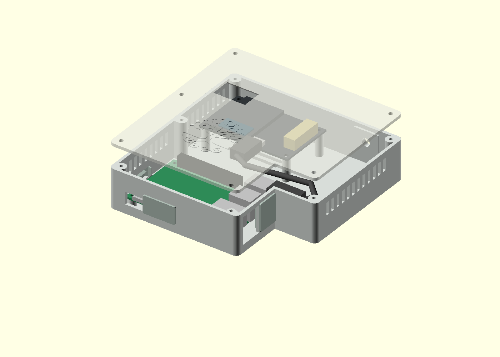
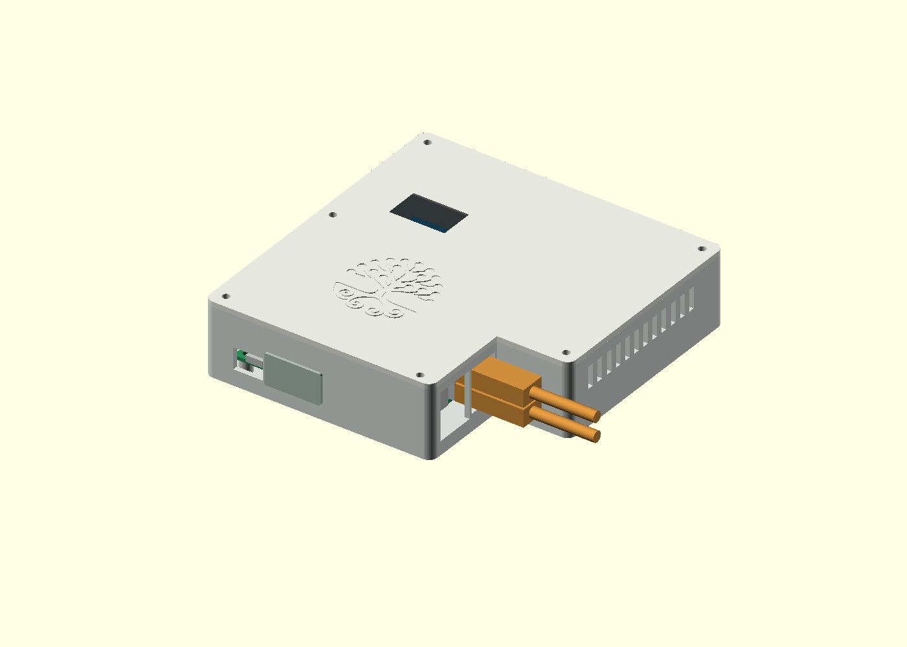
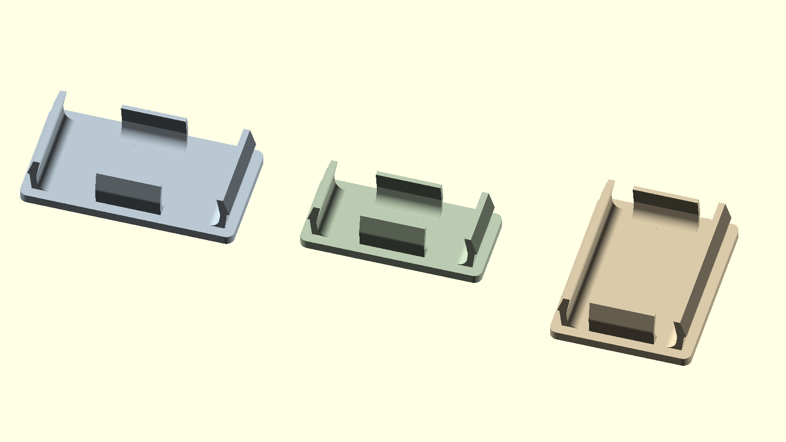

# Reality2 home router enclosure — external USB access revision

A printable base, screw-on lid and three removable service-port covers for a **Raspberry Pi Model B+ V1.2** and
**DFRobot DFR1195** connected by an internal USB-A to USB-C cable.
The case is **140 × 144 × 34.4 mm**,
excluding feet, screws and antenna. Installed service covers project 1.2 mm
from the front and left faces (141.2 × 145.2 mm overall footprint). The USB cover
sits within the side recess, so it adds no overall width. The user has used the
previous case with both **Pi 2B and Pi 3**; the board mounting positions are unchanged.
This revised recess and USB cover have not yet been physically fit-tested or thermally tested.





[Closed case with the USB cover fitted](images/closed.png).
[Lid detail showing the recessed Mariko tree](images/lid.png).

[Service view with lid/covers removed](images/service.png): external USB plugs are
orange, the internal DFR1195 cable is grey, and the optional nano Wi-Fi dongle is blue.

**Reprint the base and lid together**, plus the new USB cover. The recess has changed
and the front cable-bay lid screw has moved from Y=35 to Y=49 mm. The old lid is
not compatible. This applies when upgrading from the case without external USB.

**For the clip reinforcement update, only reprint the three covers.** Their outer
dimensions and the case openings are unchanged. Earlier PLA clips broke where
they met the face; all four fingers on each cover now have wider, rounded roots,
and the side hooks are reduced to ease insertion. A physical PETG trial is next.



## Files

- [Base STL](stl/router-base.stl)
- [Lid STL, with display window](stl/router-lid.stl)
- [HDMI clip-in cover STL](stl/router-hdmi-cover.stl)
- [SD-card clip-in cover STL](stl/router-sd-cover.stl)
- [USB-pair clip-in cover STL](stl/router-usb-cover.stl)
- [Parametric OpenSCAD source](src/router_case.scad)
- [Digital validation results](test/validation.json)

The base and lid are already oriented for printing: flat underside on the bed,
open base cavity and recessed-logo lid top facing upwards. Designed without support
structures; side windows require short bridges. Start with 0.2 mm layers,
a 0.4 mm nozzle, four perimeters and 20–30% infill. PETG is a reasonable starting
material for the prototype. Check bridge quality at the Ethernet and power openings.

## Features

- Four Pi mounting posts on the manufacturer's 58 × 49 mm hole pattern.
- Four raised DFR1195 posts on its 66 × 38 mm pattern. Both boards screw into
  printed pilot holes; the radio is raised so its LCD sits closer to the lid.
- Extended side recess exposes Ethernet and the adjacent USB pair. The socket
  faces sit about 9 mm behind the outer wall. The Ethernet opening is now
  19 × 22 mm, leaving a 1.5 mm web between it and the USB opening. No extension
  cables are required for these external sockets.
- Separate micro-USB power opening, a **24 × 12 mm full-size HDMI opening**,
  and a **20 × 8 mm microSD service opening**. HDMI and SD each have a removable
  clip-in cover; both can be serviced without taking off the lid. The SD opening
  is recessed from the board, so a fingernail or nonconductive tool may be needed.
- Both sockets in the USB stack **nearest Ethernet** are accessible with the lid
  fitted, for flashing devices or attaching a keyboard. One removable clip-in
  cover closes their shared **15 × 20 mm** opening when unused. Both sockets are
  checked simultaneously with **32 × 12 × 8 mm** plug housings and straight
  insertion/removal paths. Oversized housings need a fit check.
- Both sockets in the USB stack **furthest from Ethernet** remain internal:
  upper for the DFR1195 cable, lower for an optional nano Wi-Fi dongle. The dongle
  body allowance is **6 mm protrusion × 16 mm width × 8 mm height**, centred on
  the lower socket. This allows a little extra length over the user's reported
  roughly 5 mm protrusion. Omit it when using onboard Wi-Fi. Audio remains internal.
- A tapered 26 × 16 mm LCD window. Optional clear PET sheet can be bonded beneath the window;
  the window itself is an opening, not a printed transparent lens.
- Rear antenna bulkhead hole in the cable bay, clear of the raised radio PCB.
  The metal bulkhead's nut/washer secures it to the plastic; the antenna screws
  onto that connector. The case has no printed RF connector threads.
- Floor air inlets and 29 side vent slots, each 3 × 10 mm.
  Left-side vents stop around the middle lid screw post; right-side vents stay
  clear of the corner posts. The lid keeps its LCD window and screw holes,
  with no vent slots to interrupt the broad top surface.
  Add four adhesive feet at least 2 mm high, clear of the floor vents.
  Cooling with this vent layout needs a physical temperature test.
- The original Mariko tree symbol is recessed **0.4 mm** into the lid's top face,
  **40 mm** wide and centred at X=53, Y=46 mm, clear of the display window and
  screws. The recess leaves **2 mm** of lid thickness. There are no words or
  Reality2 marks, and the artwork is not mirrored.
- Six M3 screws secure a flat lid; no fragile snap clips or support-requiring
  underside skirt.
- Lid screw posts merge fully into the adjacent walls, filling the narrow corner
  pockets behind them. The front cable-bay post moves with the enlarged recess;
  the other five screw centres are unchanged.

## Hardware and assembly

1. Print one base, one matching lid, one HDMI cover, one SD cover and one USB cover. Print the covers
   with their flat outer faces on the bed and clips upward; use PETG for the
   flexible clips. Covers are unlabelled and distinguished by size. Clear bridge strands and check pilot-hole fit on
   spare material before installing electronics.
2. Fit the antenna pigtail's panel connector in the rear hole, using its washer
   and nut. Current assumptions: **6.5 mm hole, 4 mm panel thickness**. Measure
   your connector's barrel, flats and usable threaded length first.
3. Fit the Pi to the four low posts using four **M2.5 × 6 mm** screws. Install
   the microSD card. Pilot holes are 2.1 mm; gently form threads without overtightening.
4. Fit the DFR1195 display-up on the four taller posts, USB-C towards the Pi,
   using four M2.5 × 6 mm screws and suitable small washers if required by its
   mounting holes. Verify screw heads/washers remain within the board's clear pads.
5. Connect an **IPEX1-compatible to SMA bulkhead pigtail** to the DFR1195's LoRa
   connector. Match SMA versus RP-SMA to the actual antenna. A roughly 150 mm
   pigtail provides routing slack; keep it clear of screw posts and the lid.
6. Connect the short USB data cable internally, using the upper socket of the
   Pi USB stack furthest from Ethernet. Its lower socket accepts the optional
   nano Wi-Fi dongle. The main section is widened from 102 to 106 mm while the
   cable bay narrows from 38 to 34 mm, keeping the overall width at 140 mm and
   leaving space for the dongle behind the new recessed wall.
   The design allowance is for
   roughly **15–20 cm**, with straight plug housings around 24 mm long at USB-A
   and 20 mm at USB-C. The preview shows illustrative plug/cable envelopes,
   not a validated cable model. Route through the right bay and the gap between
   boards, without loading either USB socket.
7. Verify the LCD is entirely visible, then close with six **M3 × 10 mm**
   pan/button-head screws. Printed pilots are 2.6 mm diameter and 12 mm deep.
   M3 heat-set inserts are not included in this version.
8. Press each cover into its matching opening until the two detents seat behind
   the wall. The wider cover is HDMI. Remove with a fingernail under the outer
   flange; do not force a tight clip. The covers fit
   **24 × 12 mm HDMI**, **20 × 8 mm SD**, and **15 × 20 mm USB** openings in a **2.4 mm wall**, using four
   spring fingers: two tall side clips and two narrower top/bottom tabs.
   Side fingers are 11.8 mm tall on HDMI, 7.8 mm on SD and 19.8 mm on USB. Their relaxed shape
   extends 0.15 mm past each hole edge at the wall to address lateral and
   vertical rattle. Side hooks reach 0.45 mm beyond the hole edge (previously 0.65 mm), with their
   peaks just 0.12 mm behind the wall to reduce outward play. Tapered tips
   guide insertion. Fingers reach 4.8 mm inward.
   Each root has a **1.2 mm inward fillet** and extends **0.4 mm into the face**.
   At the face, side fingers are **2.0 mm thick** and top/bottom tabs are
   **1.8 mm thick**, tapering smoothly to the existing **0.8 / 0.6 mm** arms.
   The reinforcement stays inside the opening and ends before the wall-contact
   section, leaving the tips and spring arms free to move. The face stays 1.2 mm thick.
   Tune `hdmi_clip_preload` / `hdmi_clip_hook`, `sd_clip_preload` /
   `sd_clip_hook`, or `usb_clip_preload` / `usb_clip_hook` for each fit.
   `clip_root_radius` and `clip_root_embed` control the anchor geometry.
   Spring force and root durability still need a trial print. The USB cover's outer face is
   **17.4 × 22.4 mm**; print all three covers face-down, fingers up.
   Do not glue the caps.
9. Fit adhesive feet. Connect Ethernet and the Pi's micro-USB power externally.
10. To connect a device for flashing, remove the USB cover and plug its USB data
    cable into either exposed socket beside Ethernet. The lid, internal radio
    cable and Wi-Fi dongle stay in place. Refit the cover after unplugging.

## Confirm before a full print or batch

The PCB outline and mounting centres are documented by the manufacturers.
The **LCD aperture position comes from the annotated board image**, not a
dimensioned display drawing. The screen height and radio header heights are
estimated. The radio PCB underside is at Z=20.4 mm, PCB top at Z=22 mm, and lid
underside at Z=32 mm. This allows 10 mm above the PCB; the model assumes an
8.5 mm header and a screen face 4 mm above the PCB (6 mm below the lid).

Check these against your actual assembly:

- LCD centre approximately **25 mm along the 73 mm board edge and 8 mm inward
  from the USB-C edge**, with a roughly 22 × 11 mm visible area. Change
  `screen_xy`, `screen_size` or `radio_z` if needed.
- USB housings and bend radii; particularly the 29 mm gap between board edges.
  A stiff or very short cable may need a different layout or right-angle plugs.
- Antenna thread, nut/washer diameter, panel thickness and pigtail length.
- Ethernet plug boot and latch accessibility in the revised 19 mm-wide opening,
  and micro-USB power housing size.
- Screw and pilot-hole fit for your printer/material.
- Clip insertion/removal force and durability; the digital check confirms geometric
  engagement, not spring strength. Print a cover before committing to the full base.
- HDMI plug housing clearance (checked at 22 × 10 mm cross-section), SD-card
  reach, both external USB plugs, and the actual nano dongle. Remove a port cover
  before plugging in. The internal radio plug has 0.6 mm nominal clearance
  to the cable-bay front wall in the simplified envelope; verify its actual housing.
- Sustained operating temperature with the actual router workload and lid fitted.

## Regenerate and check

Requires OpenSCAD and Python 3. From this directory:

```sh
python3 scripts/build.py
```

Set `OPENSCAD=/path/to/openscad` if necessary. The script exports all five STL files,
checks that each is a watertight single connected mesh, and checks the case/lid
against simplified board and component envelopes. It also checks installed covers,
HDMI/SD service paths, Ethernet access, both external USB insertion paths with
the lid fitted, and simultaneous internal radio-cable/nano-dongle clearance.
It verifies that the cover
detents engage the wall when pulled outward by 0.6 mm. Coplanar seating faces are
allowed. The relaxed cover springs intentionally intersect four narrow wall-contact
regions per cover by up to 0.15 mm; validation reports that contact separately and rejects
collisions outside those regions, including all cover/electronics collisions. This does **not** prove
physical cable, connector, display or thermal fit.
Contact and retention are also checked separately for each of the three covers,
so a passing cover cannot hide another cover's failure. Retention counts only
the hooks engaging beyond the spring-preload allowance. These are geometry
checks, not a simulation or measurement of clip strength.

For interactive inspection, open `src/router_case.scad`. Change `part` to `base`,
`lid`, `hdmi-cover`, `sd-cover`, `usb-cover`, `closed`, `assembly` (exploded), `service`
(lid/covers removed), `flashing` (lid fitted, USB cover removed, both external
USB sockets in use), or `layout` (all five printable parts).
`display_window=false` generates a solid lid variant.
`lid_logo=false` omits the tree; `logo_width`, `logo_depth` and `logo_xy` control it.
The OpenSCAD Customizer's `part` dropdown switches between these views without
editing the source.
Open `test/covers.scad` to inspect the reinforced roots on all three covers.

The OpenSCAD source uses `../branding/logos/mariko_logo_traced.scad` relative to
this directory; keep the repository's `branding/` folder when editing the model.
The exported STLs are standalone and need no artwork files.

## Mechanical references

- [Raspberry Pi B+ V1.2 mechanical drawing](https://pip-assets.raspberrypi.com/categories/576-raspberry-pi-model-b/documents/RP-008351-DS-1-raspberry-pi-b-plus-mechanical-drawing.pdf)
  — 85 × 56 mm board, 58 × 49 mm mounting pattern, connector positions/heights.
  Local copy: [Pi drawing](references/pi-b-plus-mechanical.pdf).
- [DFRobot DFR1195 documentation](https://wiki.dfrobot.com/dfr1195/)
  — 73 × 45 mm board, USB-C and IPEX1 LoRa connector, annotated display image.
- [DFRobot PCB layout](https://dfimg.dfrobot.com/wiki/22836/DFR1195_lorawan-esp32-s3_layout_V1.0.pdf)
  — page 7 documents the 66 × 38 mm mounting pattern and 1.6 mm PCB thickness.
  Local copy: [DFR1195 layout](references/dfr1195-layout.pdf).

The wiki's “STP Files” ZIP contains a protective cover rather than a populated
board model. It is not used as evidence of component clearances.
